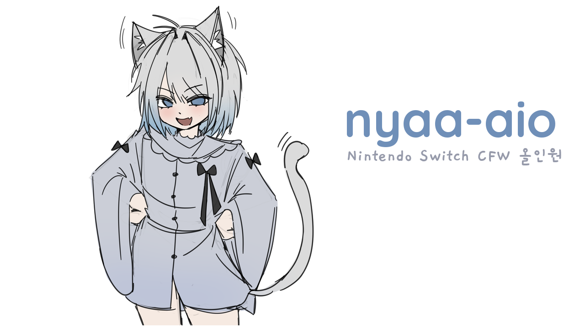

# nyaa-aio

Nintendo Switch CFW AIO 팩입니다. 구형(Erista), 개선판(Mariko), OLED, Lite를 지원합니다.

부팅 화면과 hekate 로고에는 커미션으로 받은 고양이 그림이 기본으로 들어갑니다. 다른 스플래시는 nyaa-aio 앱에서 고를 수 있습니다.

## 부팅할 때

1. **hekate 로고** (고양이, 3초): 이때 **VOL-** 를 누르면 hekate 메뉴로 갑니다.
2. **본체 키가 없으면** (`switch/prod.keys`) 한 번만 Lockpick 이 자동으로 뜹니다. 고를 것 없이 sysNAND 에서 키를 꺼내 저장하고
   hekate 로 돌아갑니다. 고급 기능(emuNAND·Amiibo 등)은 Lockpick 을 VOL- 를 누른 채 실행하면 원래 메뉴가 나옵니다.
3. **emuMMC 가 없으면** 본체 낸드(sysMMC)로 CFW 를 켜기 전에 묻습니다.
   VOL- hekate 메뉴(emuMMC 만들기) · VOL+ 이번만 sysMMC · POWER sysMMC 로 켜고 다시 묻지 않기
   (다시 묻게 하려면 `bootloader/sys/nyaa_sysmmc_ok` 를 지우세요). ini 에서 직접 고른 항목·hekate 메뉴에서 고른 부팅은 묻지 않습니다.
4. **Atmosphère 로고 대신 고양이** (2초): Atmosphère 의 boot 모듈을 같은 버전으로 다시 빌드해 로고만 바꿨습니다.
   이상하면 `atmosphere/kips/nyaa` 폴더를 지우면 원래대로 돌아갑니다.

부팅 화면은 nyaa-aio 앱에서 X(부팅 화면)를 눌러 **nyaa 고양이 / nyaa 고양이 (다크) / Atmosphère 원본** 중에 고릅니다.
"Atmosphère 원본" 을 고르면 4번의 고양이 로고도 꺼집니다. 화면에는 그 릴리스의 버전이 함께 적힙니다.

## 설치

1. [최신 릴리스](../../releases/latest)에서 `nyaa-aio.zip`을 받습니다.
2. SD 카드(FAT32 권장) 루트에 압축을 풉니다.
3. 기종에 맞게 부팅합니다: [docs/models.md](docs/models.md)

PC 설치 프로그램을 쓰면 **처음 설치 마법사**가 SD 카드 → 포맷 → 기종 → 설치 → 첫 부팅 안내 순서로 데려다 줍니다 (설정·emuMMC 보존).
카드에 emuMMC 나 게임·세이브가 있으면 포맷하지 말라고 알려 줍니다. 업데이트·오류 보고서 등은 **고급 화면**에 있습니다.
새 카드나 exFAT 카드는 마법사의 포맷 단계(또는 고급 화면의 **FAT32 포맷…** 버튼)로 FAT32 로 만들 수 있습니다 (32GB 넘는 카드도 됨, 카드 전체가 지워짐). hekate 파티션 관리자와 같은 배치(16MB 정렬, 64KB 클러스터)로 만듭니다. Windows 는 관리자 권한(UAC), macOS 는 관리자 암호, Linux 는 pkexec 로 권한을 묻습니다.
릴리스에서 Windows `nyaa-aio-windows-x64.zip`, macOS `nyaa-aio-macos-universal.zip`, Linux `nyaa-aio-linux-x64.tar.gz` 를 받으세요.
macOS 는 서명되지 않은 앱이라 처음 한 번은 Finder 에서 우클릭 → 열기 를 눌러야 합니다.

### 홈브류를 앱 모드로 (권장)

앨범으로 여는 홈브류는 메모리가 적은 애플릿 모드라 일부 앱(테마 설치기 등)이 제대로 돌지 않습니다.
홈 화면에 "홈브류 메뉴" 아이콘을 설치해 두면 항상 앱 모드로 열 수 있습니다.

1. 앨범 → sphaira 를 엽니다.
2. 파일 탐색 → `switch/nyaa-aio/nsp/HBMenu_[05A4999443B90000].nsp` 를 골라 설치합니다.
3. 홈 화면에 생긴 아이콘을 열면 앱 모드 홈브류 메뉴가 뜹니다 (설정은 팩이 `atmosphere/config/override_config.ini` 에 넣어 둠).

게임 설치(sphaira·Goldleaf)에는 본체 키(`switch/prod.keys`)가 필요합니다. 키가 없으면 부팅할 때 Lockpick 이 자동으로 떠서
만들어 줍니다 (위 "부팅할 때" 2번). 키는 본체마다 달라 팩에 들어 있지 않으니 다른 사람과 나누지 마세요.

## 펌웨어 업데이트 전에

새 스위치 펌웨어가 나오면 Atmosphère 가 지원할 때까지 며칠~몇 주 걸립니다. 그 전에 업데이트하면 CFW 로 부팅되지 않습니다.
nyaa-aio 앱(첫 화면)과 PC 앱(업데이트 확인)이 **지금 펌웨어 · Atmosphère 가 지원하는 최대 펌웨어 · 닌텐도 최신 펌웨어**를 보여 주고,
아직 지원되지 않는 펌웨어가 나왔으면 경고합니다. 경고가 보이면 본체(sysMMC)·emuMMC 업데이트와 게임 카드의 업데이트 요청을 미루세요.
릴리스 노트의 "펌웨어" 항목에도 지원 버전이 적힙니다.

## 오류가 났을 때

Atmosphère 오류 화면이 뜨거나 앱·게임이 멈추면 SD 의 `atmosphere/fatal_errors`, `atmosphere/crash_reports` 에 기록이 남습니다.
nyaa-aio 앱에서 **Y(오류 보고서)**, 또는 PC 앱의 **오류 보고서** 버튼을 누르면 무엇이 멈췄는지(추가 모듈·Atmosphère·게임 등)와
해볼 일을 한국어로 알려 줍니다. 추가 모듈이 원인이면 그 자리에서 끌 수 있습니다.

## 구성

- CFW·부트로더: Atmosphère, hekate (VOL- 를 누른 채 부팅하면 hekate 메뉴)
- 시스모듈 (켜진 채로): sys-patch, sys-con(유선 서드파티 패드), MissionControl(블루투스로 PS/Xbox 등 패드)
- 시스모듈 (꺼진 채로 — 필요한 것만 ovl-sysmodules 에서 켜기):
  sys-clk(클럭 조절), SaltyNX(FPSLocker·ReverseNX·FPS 표시에 필요), SysDVR(화면·소리를 PC/폰으로), emuiibo(아미보), ldn_mitm(LAN 플레이), sys-tune(음악)
  - 한꺼번에 많이 켜면 메모리가 모자라 부팅 중에 멈출 수 있어서 꺼 두었습니다.
- 오버레이 메뉴 Ultrahand(ZL+ZR+방향키 아래): EdiZon(치트), ovl-sysmodules(시스모듈 켜기/끄기), sys-patch,
  sys-clk, Status Monitor(FPS·클럭·온도), FPSLocker(FPS 고정), ReverseNX-RT(독/휴대 모드), QuickNTP(시계 맞추기), emuiibo, ldn_mitm, sys-tune
- 페이로드(hekate → 페이로드): TegraExplorer(파일 탐색·스크립트), Lockpick_RCM(본체 키 추출, 자동 모드판)
- 앱: nyaa-aio 업데이터, NXThemes Installer KO(홈 메뉴 테마, 한국어판), sphaira(설치 관리자·홈브류 스토어, FTP·MTP·USB 설치, 한국어), Goldleaf(파일 탐색·NSP 설치·게임/티켓 관리, 한국어), JKSV(세이브 백업), NX-Activity-Log,
  SimpleModManager(게임 모드 켜기/끄기), Moonlight(PC 게임 스트리밍), sys-clk 관리자, SysDVR 설정

### 한국어

- 한국어: nyaa-aio 업데이터·PC 설치 프로그램, hekate 메뉴(Nyx: 메인·도구·본체 정보·eMMC/emuMMC·파티션 관리자), Lockpick 화면,
  sysMMC 확인 화면, 테마 설치기, sphaira, Goldleaf, Ultrahand 메뉴, EdiZon·ovl-sysmodules 오버레이(nyaa-aio 번역 포함),
  JKSV·NX-Activity-Log·홈브류 메뉴(스위치 언어가 한국어일 때)
- 영어만 지원: hekate 의 레지스터·파일 이름 같은 기술 항목, Lockpick 고급 메뉴, sys-patch 오버레이, sys-con 앱
- 예전에 Ultrahand 를 이미 실행했다면 언어가 영어로 저장돼 있을 수 있습니다. Ultrahand 설정 → Language 에서 한국어를 고르세요.

`config/` 아래 설정(sys-con, MissionControl 등)은 업데이트해도 보존됩니다.
MissionControl 은 Atmosphère 버전에 민감합니다. 업데이트 후 부팅이 멈추면 SD 의
`atmosphere/contents/010000000000bd00/flags/boot2.flag` 를 지우고 부팅한 뒤 MissionControl 업데이트를 기다리세요.

## 버전

릴리스는 `vYYYY.MM.DD`(같은 날 두 번째부터 `.2`) 형식이며, 구성요소나 팩 설정이 바뀐 날에만 나옵니다.
릴리스 노트에 직전 릴리스 대비 바뀐 구성요소와 팩 변경 사항이 적혀 있고, 전체 버전은 `nyaa-aio.lock.json`에 있습니다.

모든 구성요소는 원 저작자의 공식 GitHub 릴리스에서 받은 것이며, 키·펌웨어·게임 파일은 포함하지 않습니다.
다음은 nyaa-aio 가 고쳐서 빌드한 GPLv2 프로그램이고, 소스를 릴리스마다 함께 올립니다:
hekate Nyx 한국어판(`hekate-ko-source.tar.gz`), 테마 설치기 한국어판(`nxthemes-ko-source.tar.gz`),
Lockpick_RCM 자동 모드판(`lockpick-nyaa-source.tar.gz`), Atmosphère boot 고양이 로고판(`amsboot-source.tar.gz`).

이 저장소는 릴리스 배포 전용입니다.
